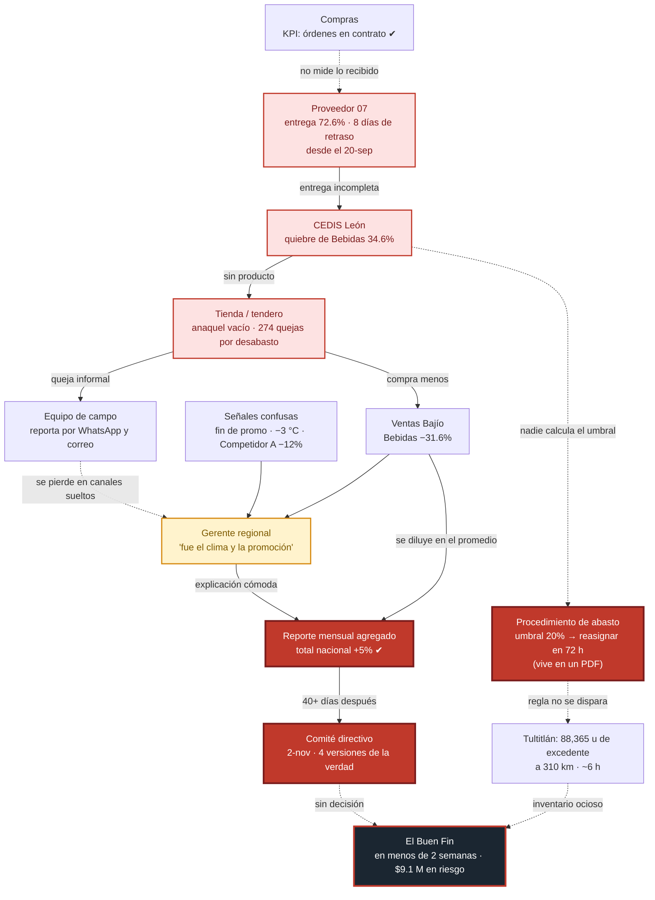

# Abarrotera del Centro: el refresco que no llegó
### Caso de estudio · Parte A: el planteamiento

> *Caso con fines de enseñanza. La empresa, las personas y los datos son ficticios. Las cifras salen de la base de datos sintética del workshop (TEC_DEMO). El caso no pretende ilustrar una gestión correcta o incorrecta, sino servir de base para la discusión.*

---

## 1. La apertura: lunes 2 de noviembre de 2026, 8:40 a.m.

Lucía Garza, directora comercial de Abarrotera del Centro, tenía veinte minutos antes del comité semanal. En la pantalla, el reporte de cierre de octubre mostraba algo que nadie había anticipado: **la venta de Bebidas en el Bajío había caído 31.6% en un solo mes**, de $23.1 a $15.8 millones de pesos.

Lo que la inquietaba no era solo el tamaño de la caída. Era que el resto del país crecía. El Centro subía 4.6%, el Norte 4.1%, el Sur 8.2%. La empresa en su conjunto se veía sana y el problema quedaba escondido en el promedio. Si hubiera mirado solo el total nacional, Lucía habría llegado al comité con buenas noticias.

En su bandeja había cuatro correos, y cada uno culpaba a algo distinto:

- El **gerente regional del Bajío** decía que la caída era "normal": había terminado la promoción *Verano refrescante* y había hecho más frío que el año anterior.
- **Compras** reportaba que "todos los proveedores están en contrato" y que no había órdenes canceladas.
- El **CEDIS León** pedía, sin dar detalles, "apoyo urgente con inventario de bebidas".
- Un **vendedor de campo en Irapuato** reenviaba el mensaje de un tendero: *"Llevo dos semanas sin encontrar refresco de 600 ml. Si ustedes no me surten, le compro a otro."*

Cuatro áreas, cuatro explicaciones y ninguna cifra en común.

### El reloj corre

Lucía hizo las cuentas con lo que tenía a mano:

- **Lo que ya se perdió:** contra lo que se esperaba vender en octubre, faltan **$8.4 millones**.
- **Lo que está en riesgo:** si noviembre se comporta igual, se pierden otros **$9.1 millones**. Son **$17.4 millones en dos meses**, en una sola categoría y una sola región.
- **La fecha límite:** faltan menos de dos semanas para **El Buen Fin**, la temporada que normalmente sube la venta 40%. Entrar con los anaqueles vacíos convertiría el mejor mes del año en el peor.
- **La regla propia:** el procedimiento interno de abasto marca que, cuando un CEDIS supera **20% de quiebre**, hay que reasignar inventario en **72 horas**. Nadie había activado esa regla, porque nadie sabía que León ya estaba en **34.6%**.

Cada día sin decidir no solo cuesta venta. También enseña a 20,000 tenderos que el competidor sí les surte.

---

## 2. El contexto en tres tiempos (SCQ)

### Situación: una máquina que funcionaba
Abarrotera del Centro surte a **20,000 tiendas** en **93 ciudades** desde **5 centros de distribución** (CEDIS): León, Tultitlán, Monterrey, Veracruz y Mérida. Maneja 1,200 productos y trabaja con 40 proveedores. Durante dos años el negocio fue predecible:
- crecía cerca de 8% anual;
- tenía picos de temporada conocidos (verano, El Buen Fin, diciembre);
- su quiebre de inventario rondaba un 3% sano en todos los CEDIS.

La meta del año era clara: **crecer sin perder disponibilidad en anaquel**. En el canal tradicional, el tendero no espera: si no hay producto, cambia de marca o de distribuidor.

### Complicación: una falla silenciosa con varias capas
A partir del **20 de septiembre**, el **Proveedor 07**, que surte Bebidas al CEDIS León y siempre había sido confiable, empezó a fallar:
- solo entregó el **72.6%** de lo pedido;
- su retraso promedio llegó a **8 días**;
- apenas **2 de cada 10 órdenes** llegaron completas y a tiempo.

El problema no se veía porque coincidió con otras tres señales que ofrecían explicaciones cómodas:
1. la promoción de verano terminó el 30 de septiembre, y la política de la empresa *espera* una baja de 10% a 20%;
2. el Bajío estuvo unos **3 °C más frío** que el año anterior;
3. el **Competidor A** lanzó un 3x2 en botanas en Guanajuato, con precios **12% más bajos**.

Cada área tenía un dato que confirmaba su propia teoría. Mientras tanto, **274 de las 328 quejas** de tenderos del Bajío en octubre hablaban de lo mismo: *no hay producto*.

### Pregunta clave
> **¿Cómo puede Abarrotera del Centro distinguir en horas, y no en semanas, una caída "esperada" de una falla de abasto, y actuar sobre ella antes de El Buen Fin sin desatender al resto de la red ni romper las reglas de acceso a la información?**

Hay preguntas derivadas para el debate: ¿quién debió ver primero el problema? ¿Por qué el procedimiento de 72 horas no se activó solo? ¿Cuánto vale la diferencia entre saber algo el día 1 y saberlo el día 40?

---

## 3. Matriz de involucrados

| Actor / Rol | Objetivos y KPIs | Dolor central | Resistencia o sesgo ante el cambio |
|---|---|---|---|
| **Lucía Garza** · Directora comercial | Venta total, margen, participación por región | Recibe cuatro versiones de la verdad y ninguna le dice *dónde* ni *por qué* | Sesgo del promedio: el total nacional crece y eso tranquiliza al consejo |
| **Gerente regional Bajío** | Venta y cumplimiento de cuota del Bajío | Su región se desploma y lo van a medir por ello | **Atribución externa:** "fue el clima y el fin de la promoción". Admitir una falla de abasto lo expone |
| **Gerente del CEDIS León** | Nivel de servicio, días de inventario, costo logístico | Ve los anaqueles vacíos, pero no controla ni compras ni proveedores | Pide ayuda sin datos y teme que la culpa recaiga en su operación |
| **Compras / Abastecimiento** | Costo de compra, cumplimiento de contrato, número de proveedores | Su indicador dice "en contrato" aunque el proveedor no entregue | Mide órdenes *emitidas*, no *recibidas completas*. Cambiar de proveedor implica renegociar y asumir riesgo |
| **Gerente del CEDIS Tultitlán (Centro)** | Su propio nivel de servicio y su preparación para El Buen Fin | Le van a pedir inventario que tiene reservado para su temporada alta | **Protección del silo:** "mi excedente es mi colchón; si lo presto, el siguiente quiebre es mío" |
| **Gerente regional Norte** | Venta del Norte (crece con *Temporada futbol*) | Ninguno inmediato; le va bien | Indiferencia y celo por la información: no quiere que se compartan sus datos ni ver datos ajenos |
| **Finanzas** | Flujo, margen, cumplimiento del presupuesto | Se entera de la pérdida al cierre, cuando ya no hay remedio | Pide certeza antes de autorizar fletes extraordinarios o un proveedor más caro |
| **TI y Datos** | Disponibilidad de sistemas, seguridad, cumplimiento | Cada área le pide "un reporte" distinto y urgente | Prudencia ante la presión: abrir datos sin control rompe la privacidad de clientes y las reglas por región |
| **Equipo de campo** (vendedores y repartidores) | Pedidos levantados, visitas, entregas a tiempo | Llegan a la tienda sin producto y absorben el enojo del tendero | Desgaste: "ya lo reportamos y nadie hizo nada" |
| **Tendero** (cliente final) | Anaquel surtido, crédito, precio competitivo | Dos semanas sin refresco de 600 ml | **Ninguna lealtad garantizada:** si el competidor surte, se va |

---

## 4. Impacto en tres niveles

### Estratégico: lo que está en juego para la empresa
- **Dinero:** $8.4 millones ya perdidos y $9.1 millones en riesgo, en una sola categoría y región. Si el desabasto alcanza El Buen Fin, la cifra puede multiplicarse.
- **Participación de mercado:** en el canal tradicional, un tendero que cambia de distribuidor en temporada alta rara vez regresa solo. El Competidor A ya está atacando Guanajuato con precio.
- **Reputación:** la promesa de valor de un distribuidor es *disponibilidad*. Fallar en el Bajío, la región industrial que más crece del país, debilita la marca justo donde está la oportunidad.
- **Gobierno corporativo:** el consejo ve un total nacional sano. El riesgo existe, pero no aparece en los reportes que el consejo recibe.

### Táctico: silos y métricas que no conversan
- **Indicadores desalineados:** Compras mide órdenes en contrato, el CEDIS mide inventario disponible y Ventas mide pesos facturados. Ninguno mide lo que sufre el cliente: *el producto que no llegó a tiempo*.
- **Información tardía y agregada:** el reporte mensual por región llega después del cierre. La falla empezó el 20 de septiembre y se vio el 2 de noviembre: **más de 40 días de ceguera**.
- **Reglas que no se disparan:** el procedimiento de 72 horas existe en un PDF, no en el sistema. Depende de que alguien calcule el quiebre a mano y lo compare con el umbral.
- **Incentivos encontrados:** reasignar inventario de Tultitlán a León ayuda a la empresa, pero castiga el indicador del gerente que presta.

### Operativo: el costo en la calle
- **Equipo de campo desgastado:** vendedores que levantan pedidos imposibles de surtir y repartidores que llegan con el camión incompleto.
- **Errores repetitivos:** cada semana se piden Bebidas al mismo proveedor que no entrega, porque el sistema de compras no aprende del incumplimiento.
- **Cliente afectado:** 328 quejas formales en octubre, y las que se dicen en el mostrador y nunca llegan a un sistema. Las tiendas también llaman al call center: las llamadas se graban, pero nadie las escucha ni las cruza con las cifras.
- **Diagnóstico manual:** cada analista arma su propia hoja de cálculo con datos distintos, y las juntas se van en discutir qué cifra es la correcta en lugar de decidir.

---

## 5. Por qué no es fácil resolverlo: las restricciones del dilema

**1. La verdad está fragmentada y protegida.**
Ventas, inventario, compras, comentarios de clientes, clima y precios de la competencia viven en sistemas distintos, con dueños distintos. Juntarlos no es solo un problema técnico, también es de **gobierno**:
- cada gerente regional solo debe ver *su* región;
- los datos personales de los tenderos (teléfono, correo, contacto) no pueden circular libremente.

La solución rápida de "darle acceso a todos a todo" viola la privacidad y las reglas internas. Pero no darlo a nadie es lo que provocó la ceguera.

**2. Hay varias causas plausibles y una cultura que premia la explicación cómoda.**
El fin de la promoción, el frío y la competencia son causas *reales*: sí restan venta. Justo por eso son excusas eficaces. Separar cuánto explica cada una exige análisis que hoy toma semanas. En una organización donde el gerente es medido por su cuota, siempre es más seguro culpar al clima que admitir una falla de proveedor.

**3. Toda acción rápida tiene un costo visible y un beneficio incierto.**
- Reasignar 88,000 unidades desde Tultitlán supone un flete extraordinario y le resta colchón al Centro antes de El Buen Fin.
- Cambiar de proveedor implica renegociar precios y asumir riesgo de calidad.
- Responder al 3x2 del competidor sacrifica margen.

Finanzas pide certeza, la operación pide velocidad, y con las herramientas actuales no se pueden tener las dos.

---

## 6. Visualización de la fricción: el circuito actual

El diagrama sigue el recorrido de la falla desde el proveedor hasta el comité. Los nodos en **rojo** son los puntos donde la información se rompe o la regla no se aplica.

**Cómo leer el diagrama:**
- Las flechas punteadas son conexiones que *deberían* existir y hoy no funcionan.
- El inventario que resolvería el problema, en Tultitlán a seis horas de León, **ya existe**. Lo que falta no es producto: es que la señal correcta llegue a la persona correcta a tiempo.

---

## Preguntas para la discusión (antes de conocer la solución)

1. Si usted fuera Lucía Garza, ¿qué *tres* preguntas haría en el comité de las 9:00 a.m. para separar los hechos de las explicaciones?
2. ¿Cuál de los indicadores actuales (de Compras, del CEDIS o de Ventas) cambiaría primero, y por qué?
3. ¿Cómo convencería al gerente de Tultitlán de ceder inventario dos semanas antes de El Buen Fin?
4. ¿Qué información debería poder consultar un gerente regional por su cuenta, y cuál debe quedar restringida? ¿Quién decide?
5. ¿Qué tendría que ser cierto para que esta crisis se detectara el día 3 y no el día 40?

*Continúa en la Parte B: la solución.*
