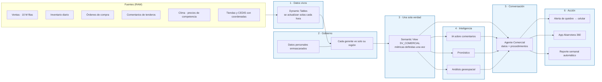
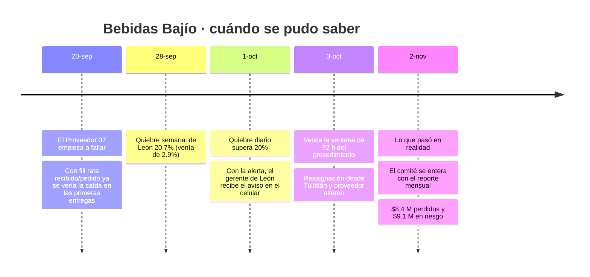

# Abarrotera del Centro: el refresco que no llegó
### Caso de estudio · Parte B: la solución

> *Continúa la Parte A. Caso con fines de enseñanza: la empresa, las personas y los datos son ficticios. Las cifras y los objetos técnicos son los del workshop "De los datos a los agentes" (base `TEC_DEMO` en Snowflake), y cada afirmación técnica remite al notebook donde se construye.*

---

## 1. La decisión de Lucía: dejar de discutir cifras

A las 9:00 a.m. Lucía no llevó una respuesta al comité, llevó una regla: *"Nadie entra a esta sala con su propia hoja de cálculo. Si no podemos ponernos de acuerdo sobre qué pasó, no podemos decidir qué hacer."*

El diagnóstico de la Parte A apunta a tres fallas de raíz, y ninguna es la falta de datos. La empresa tenía todos los datos:

| Falla de raíz | Síntoma en el caso |
|---|---|
| **Llegan tarde** | La falla empieza el 20-sep y se ve el 2-nov: más de 40 días |
| **Cada área tiene su verdad** | Compras mide órdenes en contrato y Ventas mide pesos facturados. Nadie mide lo que llegó al anaquel |
| **No se convierten en acción** | La regla de 72 horas existe, pero nadie la dispara |

La solución tiene seis capas. Cada una ataca una falla o una de las restricciones del dilema. Todas viven en una sola plataforma de datos, Snowflake, para no crear otro silo.

---

## 2. Las seis capas, explicadas para el comité

### Capa 1 · Datos vivos: de 40 días a una hora
*Notebooks `01_datos` y `02_dynamic_tables`.*

Las ventas, el inventario y las compras se cargan tal como salen de los sistemas operativos. A partir de ahí, ocho **Dynamic Tables** (tablas que Snowflake recalcula solas cuando cambian sus fuentes) construyen la capa analítica: ventas enriquecidas, ventas mensuales, inventario, compras, voz del cliente y la capa geográfica de tiendas. El objetivo de frescura (`TARGET_LAG`) es una hora, y en la demo se baja a un minuto para que el público vea entrar una venta y aparecer en el tablero.

**Qué resuelve:** el reporte mensual deja de ser la única ventana. El indicador que importaba ya estaba en los datos. El quiebre diario de Bebidas en León pasó de **2.9%** la semana del 21-sep a **20.7%** la del 28-sep, y **superó el umbral de 20% el 1 de octubre**. Con datos vivos, la empresa pudo enterarse ese mismo día, no el 2 de noviembre.

### Capa 2 · Gobierno: compartir sin exponer
*Notebook `03_gobierno`.*

Esta capa resuelve la primera restricción del dilema: *la verdad está fragmentada y protegida*. Abrir los datos a todos era inaceptable, y cerrarlos era lo que provocó la ceguera. La salida fue gobernar el dato una vez, en la plataforma, y no en cada reporte:
- **Row Access Policies:** filtran automáticamente las filas según el rol. El Gerente Norte ve sus 4,295 tiendas y nada del Bajío. La Directora Comercial ve todo. La regla vive en una sola tabla (`ACCESO_REGION`).
- **Masking Policies:** ocultan contacto, teléfono y correo de los tenderos a todos excepto a la Dirección Comercial.
- La misma regla se aplica igual en el notebook, en el agente, en la app y en el celular. Nadie puede saltársela cambiando de herramienta.

**Qué resuelve:** cada gerente puede explorar su región por su cuenta, sin pedir reportes a TI y sin riesgo de fuga. TI deja de ser el cuello de botella sin perder el control.

### Capa 3 · Una sola verdad: la Semantic View
*Notebook `04_semantic_view`.*

La **Semantic View `SV_COMERCIAL`** define en un solo lugar qué significa cada métrica: venta neta, margen, tasa de quiebre, fill rate, perfect order rate, días de inventario, venta esperada contra real. Incluye 10 consultas verificadas, que son las preguntas frecuentes del negocio con su respuesta validada.

La decisión clave fue de negocio, no técnica: **el fill rate se mide como unidades *recibidas* entre unidades *pedidas*,** no como órdenes en contrato. Con esa sola definición, el Proveedor 07 deja de verse "en contrato" y aparece como lo que es:

| Proveedor 07 en León, octubre | Valor |
|---|---|
| Fill rate | **72.6%** |
| Órdenes perfectas | **21.6%** |
| Retraso promedio | **8 días** |

**Qué resuelve:** las métricas desalineadas entre silos. Compras, CEDIS y Ventas miran el mismo número, y la discusión pasa de *qué cifra es correcta* a *qué hacemos*.

### Capa 4 · Inteligencia: separar las causas
*Notebooks `03b_inteligencia`, `03c_call_center` y `04b_mapas`.*

Esta capa ataca la segunda restricción: *varias causas plausibles y una cultura que premia la explicación cómoda*. Tres análisis, cada uno respondiendo una pregunta del comité.

**¿Qué dicen los clientes?**
- Las funciones de IA de Snowflake (`AI_CLASSIFY`, `AI_SENTIMENT`) clasifican por tema y sentimiento los 60,000 comentarios de tenderos. Basta clasificar los 16 textos distintos, así que el costo es de centavos de crédito.
- **De las 328 quejas del Bajío en octubre, 274 son por desabasto** y 54 por precio y competencia.
- `AI_AGG` las resume en un párrafo para el comité y respeta la regla de acceso: el Gerente Norte obtiene cero comentarios del Bajío.

**¿Qué dicen las tiendas por teléfono?**
- El call center graba las llamadas, pero nadie tiene tiempo de escuchar 66 minutos de audio. Una sola consulta las convierte en datos: `AI_TRANSCRIBE` separa al agente de la tienda con el segundo de cada turno, `AI_CLASSIFY` da el motivo y la urgencia, `AI_SENTIMENT` mide Logística, Servicio y Producto por separado, `AI_EXTRACT` saca la causa y el compromiso, y `AI_COMPLETE` resume cada llamada.
- **Las 3 llamadas del Bajío en octubre** (León, Querétaro, Aguascalientes) salen con sentimiento negativo en logística, y dos como desabasto con urgencia alta. Con sus palabras nombran al **CEDIS León**, al **Proveedor 07** y la salida por **Tultitlán**: la voz de la tienda confirma lo que dicen los números, días antes de que Compras lo aceptara.

**¿Cuánto debimos vender?**
- `SNOWFLAKE.ML.FORECAST` se entrenó con la historia hasta el 30 de septiembre, *antes* de la falla. Su estimación de octubre ya incluye el fin de la promoción y la estacionalidad.

  | Bebidas Bajío | Esperado | Real o escenario | Brecha |
  |---|---|---|---|
  | Octubre | $24.2 M (rango 90%: 21.3–27.0) | $15.8 M | **$8.4 M perdidos** |
  | Noviembre | $26.1 M | $17.1 M sin acción | **$9.1 M en riesgo** |

- La venta real quedó muy por debajo del rango esperado. **El fin de la promoción y el frío no alcanzan para explicar la caída:** algo se rompió.

**¿Dónde está el problema?**
- La capa geográfica (H3 y funciones geoespaciales de Snowflake) dibuja la caída en el mapa: **las 24 ciudades del Bajío caen entre −20% y −45%**, mientras las otras 69 se mueven entre −14% y +35%.
- En la frontera Bajío–Centro, el hexágono típico cae **−30.8%** contra **+6.1%** a pocos kilómetros. Mismo clima, misma competencia y mismo calendario de promociones; lo único distinto es **qué CEDIS los surte**.
- `ST_DISTANCE` sobre la red de CEDIS encuentra la salida: **Tultitlán**, a 310 km (unas 6 horas de camión), con 88,365 unidades de excedente y solo 2.5% de quiebre.

**Qué resuelve:** el mapa y el pronóstico convierten el debate de causas en una prueba. El clima no se detiene en la frontera de un CEDIS; el desabasto sí. Ya no es la palabra del gerente contra la de Compras.

### Capa 5 · Conversación: el Agente Comercial
*Notebooks `05_search` y `06_agente`.*

El **Agente Comercial** es un Cortex Agent que combina dos fuentes:
1. **Cortex Analyst** sobre la Semantic View, para responder con datos (genera el SQL y lo muestra).
2. **Cortex Search** sobre los documentos internos: el procedimiento de abasto, las políticas de promoción y los contratos.

Un directivo pregunta en español y recibe la cifra, la explicación y la regla aplicable:

> **Gerente Bajío:** *¿Por qué cayó Bebidas en octubre?*
> **Agente:** el quiebre en el CEDIS León es de 34.6%, frente a 2.7% en el resto, y coincide con la falla del Proveedor 07 desde el 20-sep. El procedimiento de abasto indica reasignar inventario en 72 horas cuando el quiebre supera 20% y activar un proveedor alterno con más de 7 días de retraso. El CEDIS más cercano con excedente es Tultitlán.

Una decisión de diseño vale para el debate: **los comentarios de clientes no van a Cortex Search, van por la Semantic View.** Así heredan la regla de acceso por región. Un buscador de texto libre habría dejado al Gerente Norte leer las quejas del Bajío.

**Qué resuelve:** la regla de 72 horas sale del PDF. El agente la conoce, la compara contra el dato vivo y la recomienda en el momento.

### Capa 6 · Acción: llevar la señal a quien decide
*Notebooks `07_reto_coco` y `08_reto_extra`, app `abarrotera-bi`, guía de CoWork.*

Un diagnóstico que nadie ve no sirve. La última capa empuja la información hacia las personas:
- **Alerta de quiebre.** Un `ALERT` de Snowflake revisa cada hora si alguna región supera 20% de quiebre en Bebidas y avisa al celular del responsable por Telegram. El responsable puede contestarle al bot, y el Agente Comercial le responde en el mismo chat.
- **App Abarrotera 360.** Es un centro de mando en React, desplegado dentro de Snowflake, con:
  - un mapa de la red con capas (rutas de abasto por estado, hexágonos en 3D, calor de la caída y quejas);
  - el flujo de valor del proveedor a la venta, con la rama de venta perdida;
  - velocímetros de salud operativa, el tracker semanal de quiebres y el pronóstico con banda de confianza;
  - el agente embebido en cada pantalla, con el botón "Pregúntale al agente sobre esta vista".
- **Reporte semanal automático (CoWork).** Un agente arma cada semana la presentación del comité con la plantilla de la empresa. El comité deja de empezar con la pregunta "¿alguien trae los números?".
- **El dato como producto (Internal Marketplace).** La capa comercial se publica como un producto de datos con dueño, descripción y reglas de acceso, para que otras áreas lo consuman sin copiarlo.

**Qué resuelve:** la tercera restricción, *la acción rápida tiene costo visible y beneficio incierto*. Ahora el beneficio tiene cifra ($9.1 M en riesgo), la acción tiene destino (Tultitlán, 6 h) y la regla tiene respaldo (el procedimiento propio de la empresa).

---

## 3. El contrafactual: el mismo octubre, con la plataforma

La diferencia entre el escenario real y el contrafactual no es de tecnología, es de **tiempo**. Son 32 días entre que el quiebre cruzó el umbral y el comité lo supo. Un mes entero de venta de Bebidas en el Bajío se jugó en ese tiempo.

*Nota de rigor: el caso no afirma que actuar el 1 de octubre habría evitado los $8.4 M completos. El efecto de reasignar inventario y cambiar de proveedor dependería de la capacidad logística real. Lo que sí afirma es que la empresa pudo decidir con 32 días de ventaja, y esa ventaja es la que hoy está en juego para noviembre.*

---

## 4. La recomendación al comité (2 de noviembre)

Con la plataforma, la recomendación cabe en una página y se apoya en el procedimiento de la propia empresa:

| # | Acción | Respaldo en los datos | Responsable | Plazo |
|---|---|---|---|---|
| 1 | **Reasignar Bebidas de Tultitlán a León** | León 34.6% de quiebre; Tultitlán con 88,365 u de excedente, 2.5% de quiebre, a 310 km | CEDIS León y Tultitlán | 72 h (procedimiento de abasto) |
| 2 | **Activar proveedor alterno para Bebidas en León** | Proveedor 07: fill rate 72.6%, 8 días de retraso (umbral del procedimiento: 7 días) | Compras | Esta semana |
| 3 | **Responder al Competidor A en botanas de Guanajuato** | 12% más barato desde el 5-oct; Botanas en Guanajuato −16.2% | Ventas Bajío y Marketing | Antes de El Buen Fin |
| 4 | **Encender la alerta y el reporte semanal** | El quiebre cruzó 20% el 1-oct y nadie lo vio | Dirección Comercial y TI | Inmediato |

**El business case:** las acciones 1 y 2 protegen los **$9.1 M** en riesgo de noviembre y entran a El Buen Fin con anaquel surtido. Su costo es un flete extraordinario de unas 6 horas y la posible diferencia de precio con un proveedor alterno. Ambos son conocibles y menores frente a lo que está en juego.

---

## 5. Cómo cambia la matriz de involucrados

| Actor | Antes (Parte A) | Después |
|---|---|---|
| **Directora Comercial** | Cuatro versiones de la verdad | Una cifra, una causa y una regla; pregunta al agente en lugar de pedir reportes |
| **Gerente Bajío** | "Fue el clima y la promoción" | El pronóstico ya descuenta la promoción y la estacionalidad, y el mapa muestra la frontera exacta. La conversación pasa de culpas a acciones |
| **CEDIS León** | Pedía ayuda sin datos | Recibe la alerta el día 1 con la cifra y el CEDIS donante sugerido |
| **Compras** | "Todos en contrato" | Su indicador mide lo recibido; el Proveedor 07 aparece en rojo en la primera semana |
| **CEDIS Tultitlán** | Protegía su excedente | La decisión se toma con datos de toda la red, su quiebre propio (2.5%) queda visible y el préstamo es una regla, no un favor. *El incentivo personal sigue siendo un tema abierto (ver sección 6)* |
| **Gerente Norte** | Celo por la información | Ve solo su región, en todas las herramientas; nadie ve sus datos sin permiso |
| **TI y Datos** | Fábrica de reportes urgentes | Gobierna una vez en la plataforma; el negocio se atiende solo, dentro de las reglas |
| **Equipo de campo** | "Ya lo reportamos y nadie hizo nada" | Sus quejas, convertidas en datos, son la evidencia número uno del diagnóstico |
| **Tendero** | Dos semanas sin refresco | Reabasto en 72 h desde el CEDIS más cercano |

---

## 6. Lo que la tecnología no resuelve

Un caso honesto debe señalar sus límites. La plataforma reduce el tiempo entre el hecho y la decisión, pero deja tres temas abiertos para el debate:

1. **Incentivos.** Mientras el gerente de Tultitlán sea evaluado solo por su propio nivel de servicio, prestar inventario seguirá castigándolo. Hay que rediseñar los KPIs, por ejemplo con un indicador de red o con crédito compartido por la venta salvada. Eso es una decisión de dirección, no de sistemas.
2. **Calidad del dato de origen.** La alerta es tan buena como el registro de inventario. Si el CEDIS registra tarde las recepciones, la plataforma verá tarde el quiebre. *Datos vivos* exige disciplina operativa en el origen.
3. **Criterio humano.** El agente recomienda con base en el procedimiento, pero no sabe, por ejemplo, si hay un bloqueo carretero entre Tultitlán y León o una negociación en curso con el Proveedor 07. La decisión final sigue siendo de una persona. El diseño correcto es que el agente prepare la decisión, no que la tome.

---

## 7. Lecciones para el salón y para el comité

1. **El problema rara vez es la falta de datos; es el tiempo y la fragmentación.** Abarrotera tenía cada dato necesario el 1 de octubre.
2. **Definir una métrica es una decisión de negocio.** Cambiar el fill rate de *contratado* a *recibido* reveló al proveedor. Ningún algoritmo lo habría hecho sin esa definición.
3. **El gobierno habilita, no frena.** La regla de acceso por región es lo que permitió dar autoservicio a todos los gerentes sin riesgo.
4. **La IA es útil cuando descansa en una sola verdad.** El agente es confiable porque responde desde la Semantic View y el procedimiento oficial, no desde la memoria de un modelo.
5. **El último kilómetro es la acción.** Una alerta en el celular del responsable vale más que el mejor tablero que nadie abre.

## Preguntas para la discusión

1. ¿Qué capa habría implementado primero con presupuesto para solo una? ¿Por qué?
2. ¿Cómo rediseñaría los KPIs de los gerentes de CEDIS para que compartir inventario sea racional para ellos?
3. ¿Qué decisiones aceptaría que tomara el agente sin aprobación humana, y cuáles nunca?
4. El contrafactual da 32 días de ventaja. ¿Qué otros procesos de su organización tienen una "regla de 72 horas" escrita en un PDF que nadie dispara?
5. Si usted fuera el Proveedor 07, ¿cómo cambiaría su relación con Abarrotera una plataforma que mide lo recibido y no lo contratado?

---

### Anexo · Dónde se construye cada capa en el workshop

| Capa | Notebook / artefacto | Objetos principales en `TEC_DEMO` |
|---|---|---|
| Datos vivos | `01_datos`, `02_dynamic_tables` | `RAW.*` (incluidas las 13 llamadas en `@RAW.AUDIOS`), 10 Dynamic Tables en `ANALITICA` |
| Gobierno | `03_gobierno` | Row Access Policy `RAP_REGION`, `ACCESO_REGION`, políticas de enmascaramiento |
| Una sola verdad | `04_semantic_view` | `ANALITICA.SV_COMERCIAL` (11 consultas verificadas) |
| Inteligencia | `03b_inteligencia`, `03c_call_center`, `04b_mapas` | `TEMAS_COMENTARIO`, `LLAMADAS_360`, `PRONOSTICO_MENSUAL`, `RED_ABASTO`, `TIENDAS_GEO` |
| Conversación | `05_search`, `06_agente` | `AGENTES.AGENTE_COMERCIAL`, Cortex Search sobre `AGENTES.DOCUMENTOS`, comentarios y turnos de llamadas |
| Acción | `07_reto_coco`, `08_reto_extra`, app `abarrotera-bi`, `docs/cowork` | `AGENTES.ALERTA_QUIEBRE`, bot de Telegram, `APPS.ABARROTERA_360` |
| Validación | `00b_validacion` | 25 pruebas automáticas que confirman que la historia se sostiene, más la huella de las 18 tablas |
